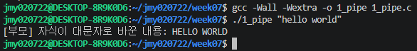
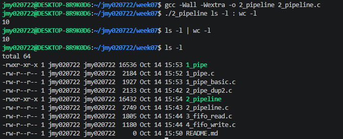
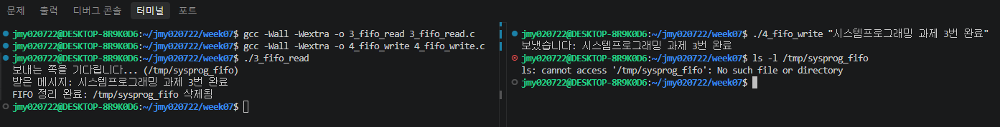

# 시스템프로그래밍 7주차 과제: IPC 파이프 및 FIFO

## 1. 프로젝트 개요
본 프로젝트는 프로세스 간 통신(IPC)의 핵심 기법인 익명 파이프(Anonymous Pipe)와 FIFO(Named Pipe)를 구현하여, 파일 디스크립터(File Descriptor) 조작과 프로세스 동기화 원리를 실습합니다.

- **과제 1 (`1_pipe.c`)**: 파이프 2개를 이용한 부모-자식 간 양방향(왕복) 통신 및 소문자→대문자 변환
- **과제 2 (`2_pipeline.c`)**: `dup2()`를 활용하여 임의의 명령어 2개를 이어 붙이는 파이프라인 구현 (`:` 구분자 사용)
- **과제 3 (`3_fifo_read.c`, `4_fifo_write.c`)**: FIFO를 이용한 독립된 두 프로세스 간 단방향 메시지 송수신 및 자원 정리

---

## 2. 과제별 세부 설명 및 핵심 원리

### 1) 과제 1: 파이프로 왕복 (`1_pipe.c`)
- **설명**: 부모 프로세스가 명령행 인자로 전달한 문자열을 파이프를 통해 자식에게 전달하고, 자식이 이를 대문자로 변환한 뒤 또 다른 파이프를 통해 부모에게 회신합니다.
- **핵심 원리**:
  - 파이프는 단방향 바이트 스트림이므로 왕복 통신을 위해 `p2c`(부모→자식), `c2p`(자식→부모) 총 2개의 파이프가 필요합니다.
  - **EOF 보장**: 각 프로세스는 쓰지 않는 파이프 끝을 즉시 닫아야 합니다. 부모는 `p2c[0]`과 `c2p[1]`을 닫고, 전송 직후 `p2c[1]`을 닫아야 자식의 `read()`가 EOF(0)를 반환하고 변환 작업으로 넘어갑니다.

### 2) 과제 2: `dup2`로 명령 이어 붙이기 (`2_pipeline.c`)
- **설명**: 터미널 명령행 인자에서 `:` 구분자를 찾아 앞 명령과 뒤 명령으로 분리한 후, 앞 명령의 출력이 뒤 명령의 입력으로 전달되도록 파이프라인을 구성합니다.
- **핵심 원리**:
  - `dup2(fd[1], STDOUT_FILENO)`: 첫 번째 자식의 표준출력을 파이프 쓰기 끝으로 교체 후 `execvp()` 실행
  - `dup2(fd[0], STDIN_FILENO)`: 두 번째 자식의 표준입력을 파이프 읽기 끝으로 교체 후 `execvp()` 실행
  - **부모의 fd 정리**: 부모가 파이프 양쪽 끝(`fd[0]`, `fd[1]`)을 모두 닫지 않으면, 뒤 명령(`cmd2`)이 파이프의 쓰기 끝이 열려 있다고 판단하여 EOF를 받지 못하고 무한 블록에 빠집니다. 따라서 부모 프로세스에서 반드시 두 끝을 모두 닫아야 합니다.

### 3) 과제 3: FIFO로 메시지 주고받기 (`3_fifo_read.c`, `4_fifo_write.c`)
- **설명**: 파일 시스템에 경로를 가지는 FIFO를 생성하여 부모-자식 관계가 없는 독립적인 두 프로세스 간 통신을 수행합니다.
- **핵심 원리**:
  - **블로킹 동기화**: `3_fifo_read`가 `open(FIFO_PATH, O_RDONLY)`를 호출하면 쓰는 쪽이 나타날 때까지 대기(블록)하며, `4_fifo_write`가 `open(FIFO_PATH, O_WRONLY)`로 여는 순간 양쪽이 동기화되어 데이터가 흐릅니다.
  - **자원 정리**: 익명 파이프와 달리 FIFO는 파일 시스템에 남으므로 통신 종료 후 반드시 `unlink(FIFO_PATH)`를 호출하여 잔여 노드를 삭제합니다.

---

## 3. 실행 화면 캡처

### 과제 1 실행 화면
> 부모가 넘긴 문자열이 대문자로 변환되어 출력되는 화면

### 과제 2 실행 화면
> `./2_pipeline ls -l : wc -l` 실행 결과와 실제 `ls -l | wc -l` 결과의 일치 화면

### 과제 3 실행 화면
> VS Code 분할 터미널을 통해 터미널 A(수신 대기)와 터미널 B(송신) 통신 및 FIFO 정리 화면

---

## 4. AI 활용 내용 및 본인의 보강 내용 (AI Policy 준수)

### 1) 사용한 주요 프롬프트
- "1_pipe_basic.c 를 변형해서 부모가 보낸 문자열을 자식이 대문자로 바꿔 돌려주는 왕복 파이프 코드 작성해줘."
- "<ctype.h> 없이 기존 코드 구조를 최대한 유지하면서 대문자로 변환하는 방법으로 수정해줘."
- "2_pipe_dup2.c를 변형해서 ':' 구분자로 두 명령어를 받아 이어 붙이는 2_pipeline.c 작성해줘. 실행 방식과 동작 원리 설명해줘."
- "3_fifo_read.c와 4_fifo_write.c를 바탕으로 open 블로킹과 unlink 정리를 반영한 코드 작성해줘."

### 2) AI가 제시한 결과물
- 파이프 2개를 생성하여 왕복 통신을 구현하는 기본 흐름 및 `<ctype.h>`의 `toupper()`를 사용한 코드 제시
- `argv`에서 `:`를 찾아 `cmd1`, `cmd2` 포인터로 분리하고 `execvp`를 호출하는 파이프라인 구조 제시
- FIFO의 `mkfifo`, `open(O_RDONLY)` 블로킹 및 `unlink` 구조 제시

### 3) 본인의 보강 및 개선 사항 (차이점)
- **외부 헤더 의존성 제거**: AI 초안에서 사용된 `<ctype.h>` 라이브러리를 제거하고, 아스키코드 연산(`buf[i] - 'a' + 'A'`)을 직접 작성하여 기존 베이스 코드 스타일과 일치하도록 최적화했습니다.
- **예외 처리 및 안전성 강화**: 
  - 과제 1에서 인자가 전달되지 않았을 때의 예외 처리(`argc < 2`)를 명확히 추가했습니다.
  - 과제 2에서 구분자 `:`가 맨 앞 또는 맨 뒤에 오거나 생략된 경우의 비정상 실행을 방어하도록 유효성 검증 로직을 보강했습니다.
  - 강의 슬라이드 기준에 맞춰 `pipe`, `fork`, `dup2`, `unlink` 등 모든 시스템 호출의 반환값을 철저히 점검하고 `_exit(127)` 등 적절한 종료 코드를 지정했습니다.
- **자원 누수 검증**: 슬라이드 31p/33p 지침에 따라 실행 후 `ls -l /tmp/sysprog_fifo`로 파일 시스템 잔여물이 남지 않는지 교차 검증을 완료했습니다.